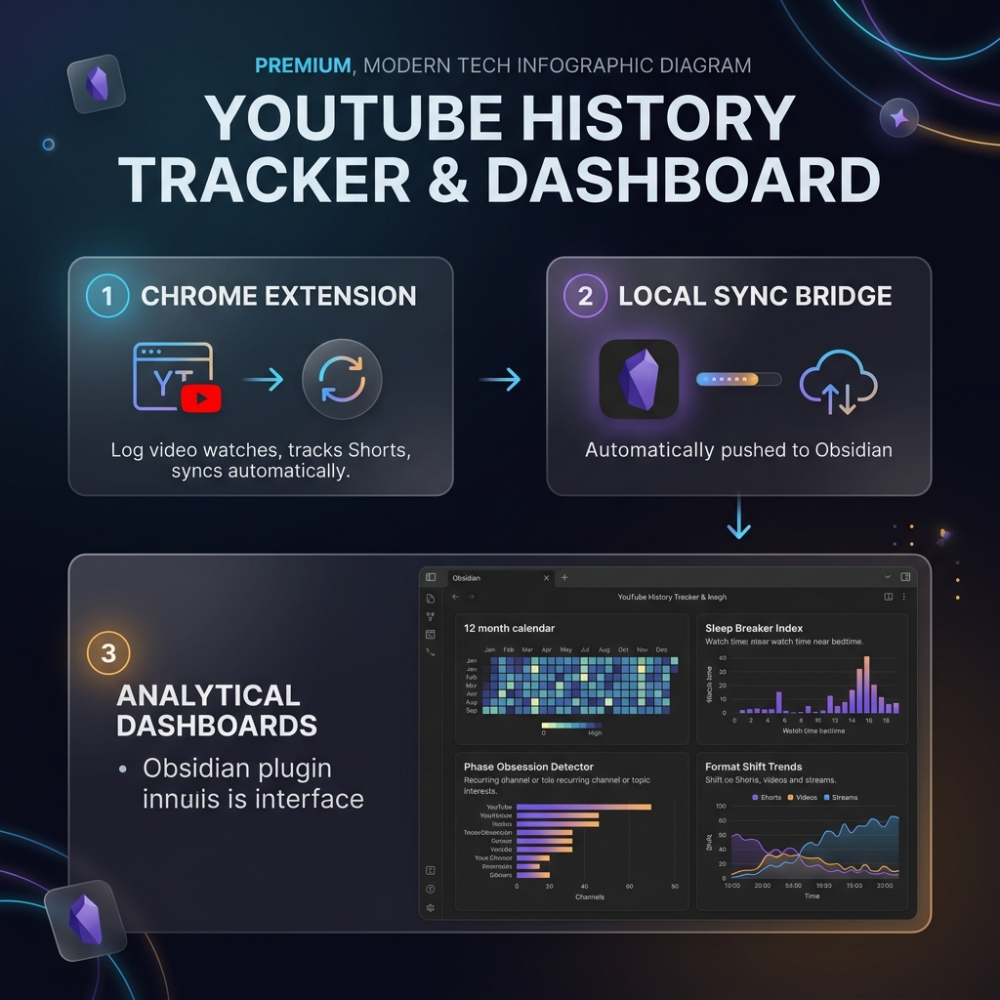

# 📊 YouTube Watch Tracker Suite

A premium, privacy-first analytics suite to capture, analyze, and visualize your YouTube watch habits. The suite consists of three fully integrated components designed to work together seamlessly:

1. **Chrome Extension**: Runs in the background to automatically log YouTube watch activity, calculate exact watch durations, and instantly push new watches to Obsidian.
2. **Obsidian Plugin**: Natively displays an interactive Glassmorphic analytics dashboard inside your local markdown vault, complete with daily note Copy-to-Clipboard integrations.
3. **Web Dashboard**: A stand-alone, client-side, zero-install dashboard to load and analyze watch history JSON files in any browser with premium, high-performance visual graphs.

---

## 🎨 Visual Workflow & Architecture

---

## ✨ Key Features

### 📅 Watch History Calendar & 4x3 Heatmap Grid
* View your complete history on a single page with a **side-by-side 4x3 month watch grid** containing color-coded intensity cells based on watch count and time-of-day temperature.
* **Video-Specific Calendars**: Click the calendar icon next to any video in your history or stats list to open a dedicated modal overlay displaying that video's precise watch calendar over the years.
* **Highlight Top Toggle**: Focus the calendar dynamically to highlight only watches belonging to your top rewatched videos list.

### ⚖️ Weekend vs. Weekday Shift Analysis
* Compare average video durations, channel interests, and primary genres between Saturdays & Sundays versus weekdays.
* Discover shifts in your viewing profile (e.g., switching from short, tactical videos during the workweek to long-form documentaries on weekends).
* **Takeout Fallback Logic**: Automatically falls back to displaying Activity Shifts (weekday/weekend watches per active day) and Watch Volume trends if watch duration data is missing from imports.

### 🔍 The "Phase" Detector
* Identify high-intensity, short-lived obsessions. The scanner flags channels or topics that suddenly jumped to your top-watched list for a 30-to-60-day window and then completely vanished.
* Click any detected obsession phase to instantly highlight it on the calendar heatmap with a golden pulse animation.

### 📈 Format Shift Analysis
* A responsive trend chart showing whether your average video duration or format preference is shrinking or growing over the years.
* Displays badged counts of short-form (Shorts), medium, and documentary-length watches over time.

### 🌙 Late-Night ("Sleep Breaker") Index
* Filter stats using custom night-time ranges (e.g., 12 AM to 4 AM) to identify channels that break your sleep schedule, complete with nested video breakdown lists.

### ⚡ Chrome-Obsidian Sync Bridge
* Features an automated background sync server running locally on port `12314`. The Chrome extension pushes new watches to Obsidian in real-time.

### 🔍 Advanced Search Engine
* Search inputs support boolean logic (`AND`, `OR`, `NOT` negation `-term`), exact double-quoted phrases (`"exact phrase"`), and regular expressions (`/pattern/`).
* Interactive search histories with floating dropdowns.

---

## 🚀 Installation & Setup

### 1. Chrome Extension
1. Clone or download this repository.
2. Open Chrome and navigate to `chrome://extensions/`.
3. Enable **Developer mode** in the top-right corner.
4. Click **Load unpacked** in the top-left and select the `chrome-extension/` directory.
5. Click the extension icon to set up settings.

### 2. Obsidian Plugin
1. Open your Obsidian vault folder.
2. Ensure hidden files are shown and navigate to `.obsidian/plugins/`.
3. Create a new directory named `yt-watch-tracker`.
4. Copy `manifest.json`, `main.js`, and `styles.css` from the `obsidian-plugin/` directory into that folder.
5. In Obsidian, go to **Settings** > **Community plugins**, click reload, and enable **YouTube Watch Tracker Dashboard**.
6. Set the Sync Bridge settings (default port `12314`) and enable the server.

### 3. Web Dashboard
1. The web dashboard is static and runs entirely client-side.
2. Simply open `web-dashboard/index.html` in any modern web browser.
3. Import your exported watch history JSON or a Google Takeout JSON to view your stats instantly.

---

## 🔒 Privacy & Data Policy
All data stays local on your machine. The Chrome extension stores logs locally in `chrome.storage.local`, and the Obsidian plugin saves watch databases inside your vault's `yt-history.json` file. No servers are contacted, and no metrics leave your device.
